# Rizal Docs — Aplikasi Repositori & Koleksi Dokumen

Aplikasi Flutter untuk UTS Mobile Programming dengan tema **Repositori / Koleksi Dokumen**
(dipilih berdasarkan **NIM berakhiran 7**). Aplikasi memungkinkan pengguna mendaftar,
login, melihat koleksi dokumen, membaca detail dokumen, menandai favorit, serta
mengelola data dokumen (create, read, update, delete) secara lokal menggunakan SQLite.

## Identitas Mahasiswa

| Keterangan | Data |
| --- | --- |
| Nama Lengkap | **RIZAL SURYAWAN** |
| NIM | **241011750067** |
| Kelas | **04SIFE002** |
| Program Studi | Sistem Informasi S-1 |
| Kampus | Universitas Pamulang |
| Tema Aplikasi | Repositori / Koleksi Dokumen (NIM berakhiran 7) |
| Nama Aplikasi | **Rizal Docs** |

Identitas di atas ditampilkan pada halaman login, halaman registrasi, halaman profil,
serta pada *footer* halaman autentikasi.

## Ringkasan Fitur

- Autentikasi lokal (registrasi & login) dengan SQLite.
- Validasi form menggunakan `Form`, `GlobalKey<FormState>`, dan `TextFormField`.
- Dashboard dengan header, body yang dapat di-scroll, dan `BottomNavigationBar` 4 tab
  (Beranda, Favorit, Pengaturan, Profil).
- Daftar dokumen dari database lokal dengan gambar sampul dari aset lokal.
- Pencarian judul/penulis dan filter kategori.
- Halaman detail dokumen dengan gambar, judul, deskripsi, dan informasi tambahan.
- Aksi favorit dengan dialog konfirmasi dan umpan balik `SnackBar`.
- Pengelolaan dokumen (tambah, ubah, hapus) pada menu Pengaturan.
- Seluruh gambar berasal dari folder `assets/images/` (tanpa internet).

## Pemenuhan Soal UTS

### Soal 1 — Identitas & Aset Lokal (20%)

| Ketentuan | Implementasi |
| --- | --- |
| Nama project/aplikasi sesuai mahasiswa | Package `rizal_apps`, judul aplikasi **Rizal Docs**, label Android **Rizal Docs** |
| Halaman login menampilkan foto profil bertema | `assets/images/profile/profile_rizal.png` pada `lib/features/auth/widgets/auth_scaffold.dart` |
| Logo aplikasi | `assets/images/brand/logo_rizal_docs.png` pada AppBar dashboard |
| Semua gambar dari aset lokal | `pubspec.yaml` mendaftarkan `assets/images/profile/`, `brand/`, `covers/` |
| Struktur folder aset | Dijelaskan pada bagian [Struktur Folder Aset](#struktur-folder-aset) |

### Soal 2 — Login & Registrasi (20%)

| Ketentuan | Implementasi |
| --- | --- |
| `TextFormField` di dalam `Form` + `GlobalKey<FormState>` | `lib/features/auth/login_page.dart`, `lib/features/auth/register_page.dart` |
| Method `actionLogin()` | `login_page.dart` — memvalidasi form lalu memanggil `AuthRepository.login()` |
| Method `actionRegistrasi()` | `register_page.dart` — memvalidasi form lalu memanggil `AuthRepository.register()` |
| Validator tidak boleh kosong | `lib/core/utils/validators.dart` (`AppValidators.username`, `password`, dll.) |
| Password minimal 6 karakter | `AppValidators.password` |
| Pesan error di bawah field | Ditampilkan otomatis oleh `TextFormField.validator` |
| Login berhasil → SnackBar "Login berhasil" → Dashboard | `login_page.dart` |
| Login gagal → AlertDialog "Username atau password salah" + tombol OK | `login_page.dart` |
| Data pengguna disimpan di SQLite | Tabel `users` pada `lib/core/database/database_helper.dart` |

### Soal 3 — Dashboard (25%)

| Ketentuan | Implementasi |
| --- | --- |
| Header (AppBar) | `Rizal Docs` + sapaan pengguna di `lib/features/dashboard/dashboard_page.dart` |
| Body dapat di-scroll | `ListView` pada `lib/features/dashboard/widgets/home_tab.dart` |
| Footer `BottomNavigationBar` | 4 tab pada `dashboard_page.dart` |
| Wajib `StatefulWidget` | `DashboardPage` dan `HomeTab` adalah `StatefulWidget` |
| Daftar data dari aset lokal | `DocumentCard` + gambar `assets/images/covers/` |
| Menampilkan nama pengguna login | Sapaan `Halo, <nama>` pada header dashboard |

### Soal 4 — Menu Pengaturan & Detail (25%)

| Ketentuan | Implementasi |
| --- | --- |
| Menu Pengaturan berisi CRUD | `lib/features/settings/settings_page.dart` + `document_form_page.dart` |
| Detail via `Navigator.push` | `home_tab.dart` dan `favorites_page.dart` membuka `DocumentDetailPage` |
| Detail menampilkan gambar, judul, deskripsi, informasi tambahan | `lib/features/documents/document_detail_page.dart` |
| Tombol aksi "Tambah ke Favorit" / "Hapus dari Favorit" | Bagian bawah halaman detail |
| Dialog konfirmasi "Yakin ingin menambahkan ... ke favorit?" dengan Ya/Batal | `document_detail_page.dart` |
| SnackBar setelah aksi berhasil | "Dokumen berhasil ditambahkan ke favorit" / "Dokumen dihapus dari favorit" |

## Struktur Project

```text
lib/
├── main.dart                      # Entry point, inisialisasi locale Indonesia
├── app.dart                       # MaterialApp + theme + splash
├── core/
│   ├── constants/app_constants.dart
│   ├── database/database_helper.dart   # SQLite: versi, tabel, seeding
│   ├── theme/app_theme.dart
│   ├── utils/date_formatter.dart
│   ├── utils/validators.dart
│   └── widgets/                   # Komponen umum (field, tombol, feedback)
├── data/document_seed.dart        # 6 data dokumen awal
├── models/
│   ├── document.dart
│   └── user.dart
├── repositories/
│   ├── auth_repository.dart
│   └── document_repository.dart
└── features/
    ├── splash/splash_page.dart
    ├── auth/                      # login, registrasi, scaffold autentikasi
    ├── dashboard/                 # dashboard + tab beranda
    ├── documents/                 # detail, form CRUD, kartu dokumen
    ├── favorites/favorites_page.dart
    ├── profile/profile_page.dart
    └── settings/settings_page.dart

assets/
└── images/
    ├── profile/profile_rizal.png
    ├── brand/logo_rizal_docs.png
    └── covers/cover_01.png ... cover_06.png

test/                              # Unit & widget test
integration_test/app_test.dart     # Pengujian end-to-end
tool/generate_assets.ps1           # Generator aset lokal (System.Drawing)
docs/screenshots/                  # Screenshot dokumentasi
```

### Struktur Folder Aset

Seluruh gambar dibuat secara lokal melalui `tool/generate_assets.ps1` sehingga tidak
memerlukan koneksi internet.

```text
assets/images/
├── profile/
│   └── profile_rizal.png      # Foto profil bertema untuk halaman login & profil
├── brand/
│   └── logo_rizal_docs.png    # Logo aplikasi pada AppBar
└── covers/
    ├── cover_01.png           # Bisnis Digital dan Kewirausahaan
    ├── cover_02.png           # Kecerdasan Buatan Terapan
    ├── cover_03.png           # Manajemen Proyek Perangkat Lunak
    ├── cover_04.png           # Basis Data Relasional
    ├── cover_05.png           # Metodologi Penelitian Sistem Informasi
    └── cover_06.png           # Pemrograman Mobile dengan Flutter
```

Registrasi folder pada `pubspec.yaml`:

```yaml
flutter:
  uses-material-design: true
  assets:
    - assets/images/profile/
    - assets/images/brand/
    - assets/images/covers/
```

## Skema Database

Database SQLite: `rizal_docs.db` (versi 2).

**Tabel `users`**

| Kolom | Tipe | Keterangan |
| --- | --- | --- |
| `id` | INTEGER | Primary key autoincrement |
| `nama` | TEXT | Nama lengkap |
| `username` | TEXT | Unik |
| `password` | TEXT | Password (lihat catatan keamanan) |
| `created_at` | TEXT | Waktu pendaftaran |

**Tabel `documents`**

| Kolom | Tipe | Keterangan |
| --- | --- | --- |
| `id` | INTEGER | Primary key autoincrement |
| `title` | TEXT | Judul dokumen |
| `category` | TEXT | Kategori |
| `author` | TEXT | Penulis |
| `year` | INTEGER | Tahun terbit |
| `description` | TEXT | Deskripsi |
| `image` | TEXT | Path aset sampul |
| `is_favorite` | INTEGER | 0/1 status favorit |
| `created_at` | TEXT | Waktu dibuat |
| `updated_at` | TEXT | Waktu diubah |

Migrasi `onUpgrade` versi 1 → 2 menambahkan tabel `documents` beserta 6 data awal.
Data awal hanya di-seed sekali agar perubahan pengguna tidak tertimpa.

## Cara Menjalankan

Prasyarat: Flutter SDK (Dart 3.12+) dan Android SDK/emulator.

```bash
flutter pub get
flutter run
```

Build APK:

```bash
flutter build apk --release
# hasil: build/app/outputs/flutter-apk/app-release.apk
```

Membuat ulang seluruh aset gambar (opsional, Windows):

```powershell
powershell -ExecutionPolicy Bypass -File tool/generate_assets.ps1
```

## Pengujian

```bash
# Analisis statis
flutter analyze

# Unit & widget test (11 test)
flutter test

# Pengujian end-to-end pada emulator/perangkat
flutter test integration_test/app_test.dart -d <device-id>
```

Pengujian end-to-end mencakup: registrasi → login → buka detail → tambah favorit →
tab favorit → tambah dokumen → ubah dokumen → hapus dokumen.

## Screenshot Aplikasi

| Halaman Login | Registrasi Berhasil |
| --- | --- |
| 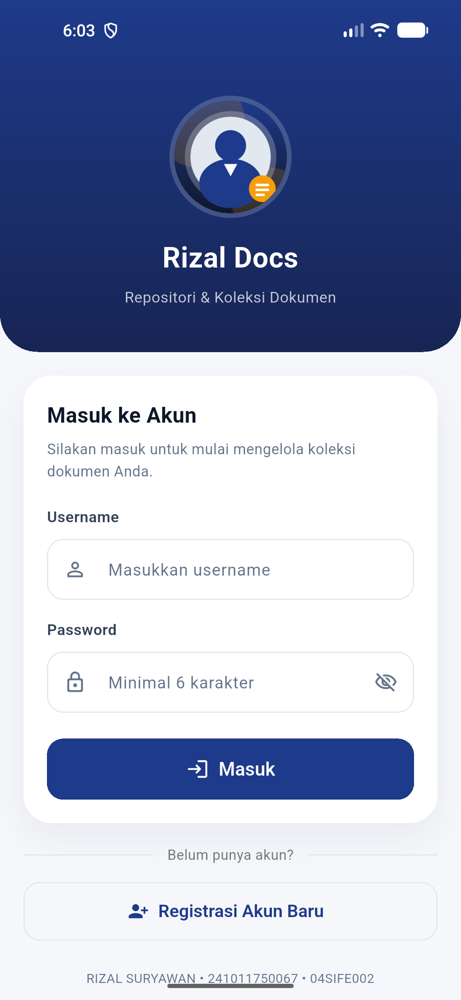 | 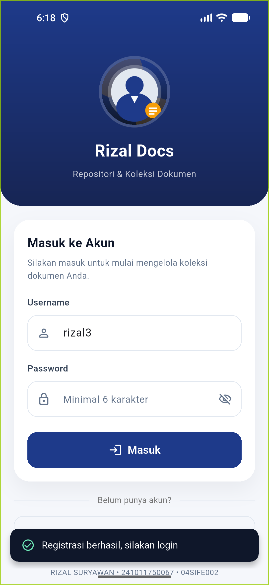 |

| Login Berhasil | Dashboard |
| --- | --- |
| 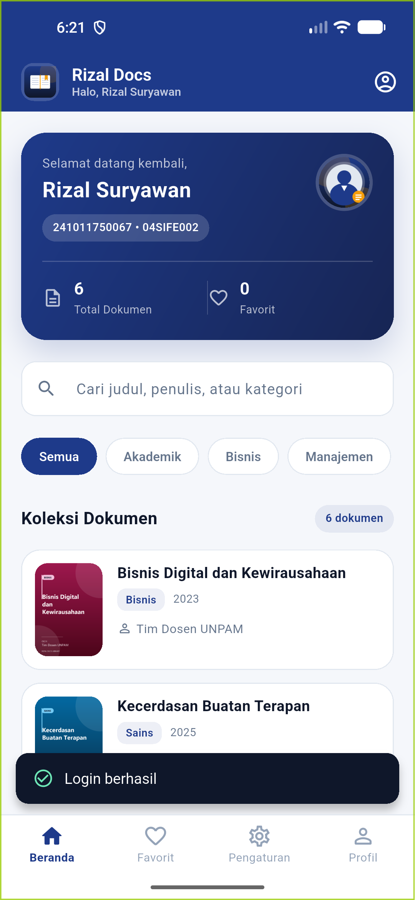 | 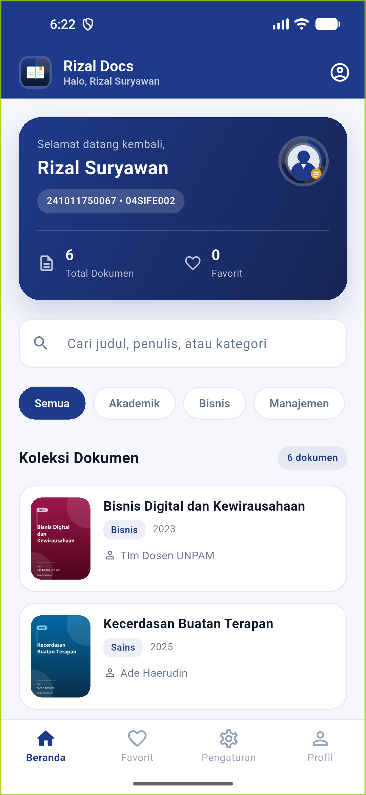 |

| Detail Dokumen | Konfirmasi Favorit |
| --- | --- |
| 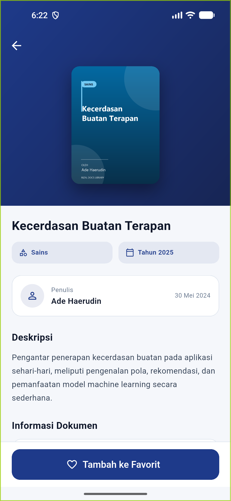 | 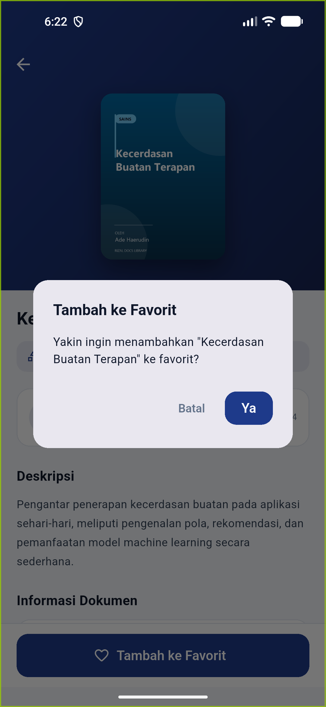 |

| Favorit Tersimpan | Tab Favorit |
| --- | --- |
| 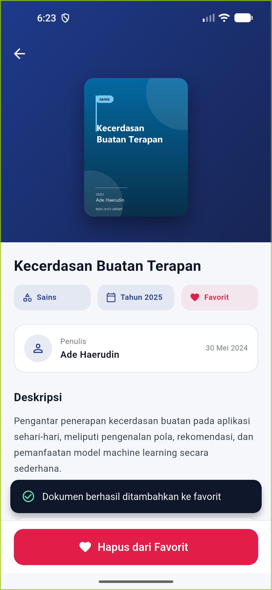 | 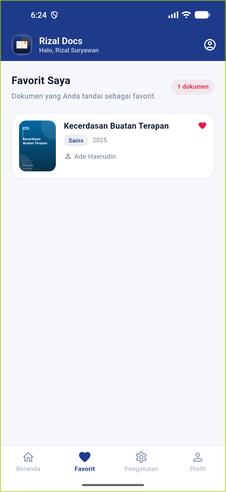 |

| Pengaturan (CRUD) | Profil Mahasiswa |
| --- | --- |
| 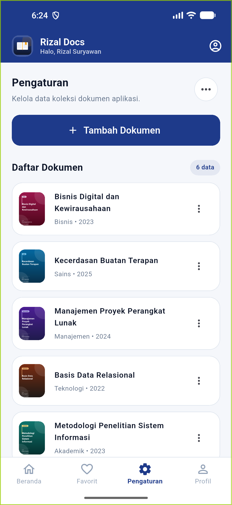 | 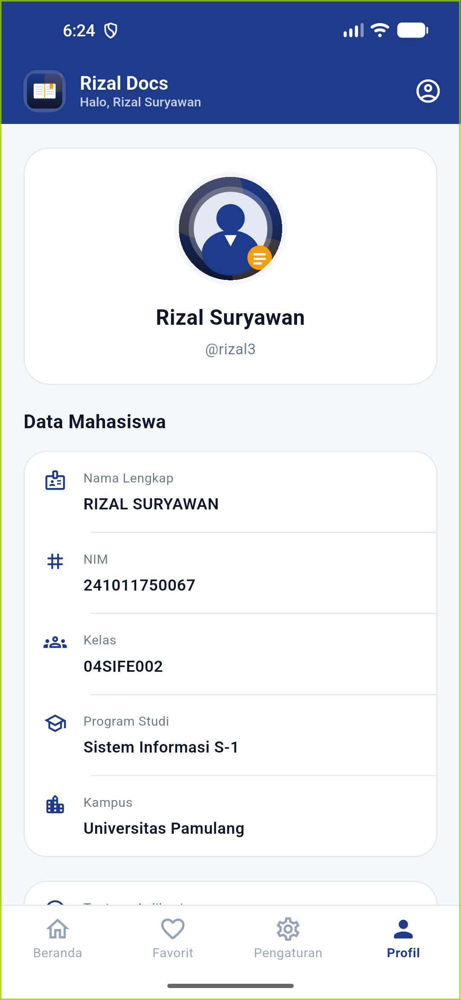 |

| Login Gagal |
| --- |
| 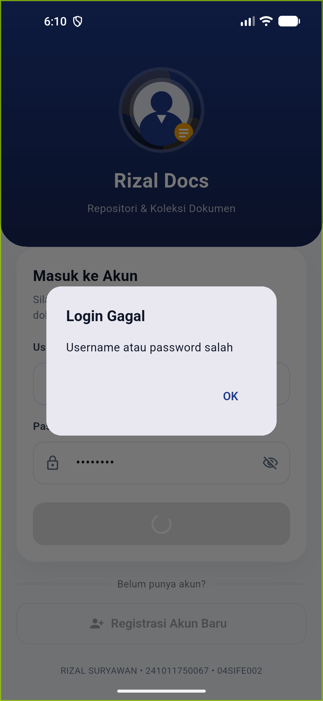 |

## Catatan Keamanan

Password disimpan sebagai teks biasa di SQLite karena fokus pembelajaran pada alur
autentikasi dan validasi form. Pada aplikasi produksi, password wajib di-hash
(misalnya dengan `bcrypt`/`argon2`) dan disimpan sebagai hash, bukan teks asli.

## Riwayat Commit

Pekerjaan dilakukan bertahap per fitur pada branch `uts`:

1. `chore:` setup project dan skeleton aplikasi
2. `feat(assets):` aset gambar lokal (profil, logo, sampul)
3. `feat(auth):` login & registrasi dengan SQLite dan validasi form
4. `feat(dashboard):` header, body scroll, dan bottom navigation
5. `fix(auth):` penyelarasan header halaman autentikasi
6. `feat(documents):` seeding dokumen dan daftar dokumen
7. `feat(documents):` halaman detail + konfirmasi favorit
8. `feat(documents):` CRUD melalui menu Pengaturan
9. `feat(favorites):` tab favorit dari database
10. `test:` unit test, widget test, integration test, dan dokumentasi
